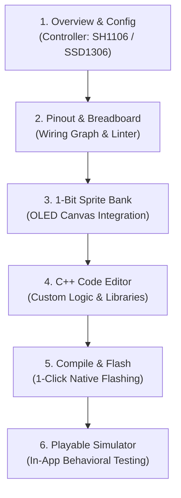

# Spec 012 — Projects Studio & Universal Embedded Project Hub

## 1. Goal & Product Vision

PixelForge is not just a drawing tool or a single pre-baked game viewer. It is a **one-stop creative engineering studio** for embedded displays and maker hardware.

**Spec 012** formalizes the **PixelForge Projects Studio**:
A unified workspace that bridges software graphics, hardware pinout routing, embedded C++ coding, and device provisioning into an integrated, repeatable project lifecycle.

```text
┌────────────────────────────────────────────────────────────────────────┐
│                      PIXELFORGE PROJECTS STUDIO                        │
├────────────────────────────────────────────────────────────────────────┤
│  [ MY PROJECTS ]          [ BLUEPRINT & FIRMWARE GALLERY ]   [+ NEW]   │
│                                                                        │
│  Active Project: 🚀 Space Shooter Arcade                               │
│  ┌──────────────┬──────────────┬──────────────┬─────────────┬────────┐ │
│  │ 🎮 Simulator │ 📌 Pinout &  │ 👾 1-Bit     │ ⚡ C++ Code &│ ⚙️     │ │
│  │    Preview   │   Breadboard │   Assets     │   Flasher   │ Config │ │
│  └──────────────┴──────────────┴──────────────┴─────────────┴────────┘ │
└────────────────────────────────────────────────────────────────────────┘
```

The Projects Studio operates on two distinct tiers:
1. **Tier 1: Firmware & Blueprint Gallery (Showcase Blueprints & Starter Kits)**
   - Curated, tested, ready-to-run demo projects for quick onboarding (Space Shooter Arcade, Rotary Reel Scrubber, Dual-OLED HUD, Weather Station).
   - Serves as interactive documentation and inspirational starting points.
   - 1-click clone into a custom project or 1-click flash.
2. **Tier 2: Universal Custom Project Studio (My Projects)**
   - Every project is a standalone, fully editable entity with:
     - **Custom Hardware Pinout**: Peripheral catalog integration, visual wiring netlist, real-time electrical linting, and automated `pinout.h`.
     - **1-Bit Asset Bank**: Custom sprites and frames directly editable in the PixelForge 128×64 Canvas.
     - **Embedded C++ Editor**: In-app code editor for `main.cpp` with compilation/flashing pipelines.
     - **Hardware Config**: Switching between display controllers (1.3" SH1106 vs 0.96" SSD1306), I2C bus speeds, and MCU targets.
     - **Live Simulation**: In-app behavioral simulation before burning physical flash.

---

## 2. Project Data Model (`PixelForgeProject`)

Every project is serialized into a portable JSON structure:

```typescript
export interface PixelForgeProject {
  id: string;
  name: string;
  description: string;
  category: 'Game' | 'Animation' | 'HUD' | 'Sensor' | 'Custom';
  createdAt: string;
  updatedAt: string;
  icon: string;
  targetBoard: string; // e.g. 'esp32-devkit-v1-30p'
  display: {
    width: number;
    height: number;
    controller: 'SH1106' | 'SSD1306' | 'SSD1309' | 'GENERIC_OLED';
    driver: 'U8G2' | 'Adafruit';
    i2cAddress: number;
    sdaGpio: number;
    sclGpio: number;
  };
  wiringPreset?: 'space_shooter' | 'oled_default' | 'reel_station' | 'dual_oled' | 'blank';
  wiring?: WiringProjectSchema;
  sprites: ProjectSprite[];
  customCode: string;
  isTemplate?: boolean;
}
```

---

## 3. Curated Blueprint & Firmware Gallery

The initial gallery includes four standard reference blueprints:

### Blueprint 1: 🚀 Space Shooter Arcade
- **Target Hardware**: ESP32 + 1.3" SH1106 / 0.96" SSD1306 OLED + 2× Tactile Buttons.
- **Pinout**: SDA=D21, SCL=D22, BtnLeft=D18, BtnRight=D19.
- **Engine**: 30 FPS non-blocking loop, continuous cadence blaster, AABB collision, animated alien sprites.

### Blueprint 2: 🎛️ Animation Reel Scrubber
- **Target Hardware**: ESP32 + 128×64 OLED + EC11 Rotary Encoder with Push Button.
- **Pinout**: SDA=D21, SCL=D22, EncCLK=D18, EncDT=D19, EncSW=D5.
- **Engine**: Quadrature decode, bidirectional frame scrubbing, play/pause toggle.

### Blueprint 3: 📟 Dual-OLED Multi-Display HUD
- **Target Hardware**: ESP32 + Primary 128×64 OLED (0x3C) + Secondary 128×32 OLED (0x3D).
- **Pinout**: Shared I²C bus (D21/D22) with address jumper differentiation.
- **Engine**: Dual buffer dispatch, telemetry streaming, system telemetry readouts.

### Blueprint 4: ✨ Blank Creative Canvas
- **Target Hardware**: Unassigned / Custom.
- **Purpose**: Clean slate for makers designing novel sensor dashboards, game engines, or custom IoT nodes.

---

## 4. Custom Project Lifecycle & Studio Workflow

Inside any open project, makers move fluidly across five modular workspaces:



1. **Config & Display Profiling:**
   Set the exact display glass (1.3" SH1106 vs 0.96" SSD1306) and I2C address (`0x3C` vs `0x3D`).
2. **Pinout & Breadboard Canvas:**
   Drag and drop peripherals, route wires, verify strapping pin safety, and generate clean C++ pinout headers (`pinout.h`).
3. **1-Bit Sprite Asset Bank:**
   Store project-specific icons and sprites. One-click "Open in Canvas" lets the user edit any sprite in the 128×64 Draw Studio.
4. **C++ Code & Firmware Pipeline:**
   Edit the complete project source code directly in PixelForge.
5. **Native Flashing:**
   One-click flashing to connected serial COM port without needing external toolchains.

---

## 5. Hardware Safety & Portability

- **No Bootloader Collisions**: Project pinout validation strictly blocks assigning output peripherals to strapping pins (GPIO 0, 2, 12, 15) or input-only pins (GPIO 34–39).
- **Portable JSON Project Format**: Entire projects (wiring netlist, sprite bitmaps, C++ sketch, display settings) export to a single `.pfp.json` bundle for sharing and backup.

---

## 6. Dual-Target Firmware Architecture

PixelForge strictly segregates two firmware categories to preserve desktop protocol capabilities while enabling rich embedded standalone apps:

| Firmware Target | Source Location | Binary Output | Primary Role & Capabilities |
| :--- | :--- | :--- | :--- |
| **PixelForge Official OS / Runtime** | `firmware/src/` | `src-tauri/resources/pixelforge_firmware.bin` | **Desktop Companion**: Bi-directional USB serial protocol, 60 FPS live video streaming, LittleFS persistent animation reel storage, and real-time CPU/RAM/FPS telemetry reporting for the Hardware Monitor. |
| **Projects Studio Blueprints** | `firmware/projects/<project_id>/` | `src-tauri/resources/<project_id>.bin` | **Standalone Embedded App**: Autonomous games and sensor nodes (e.g., Space Shooter Arcade). Runs offline without PC connection, directly sampling physical hardware inputs (GPIO buttons, encoders). |

### 1-Click Switching Workflow:
- In **Projects Studio**: Clicking **"⚡ Flash <Project Name>"** installs the standalone embedded blueprint firmware onto the device.
- In **Hardware Monitor**: Clicking **"⚡ Flash PixelForge Official OS"** restores the desktop companion firmware, immediately re-enabling live video streaming, animation reels, and serial telemetry.
